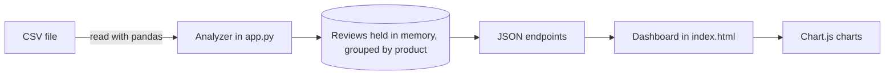

# E-commerce Product Review Analyzer

A web dashboard that takes a CSV of customer reviews and shows how each product is actually being received: how many reviews are positive, neutral or negative, what people wrote, and how the split looks as a chart.

**Live demo:** [e-commerce-product-review-analyzer.onrender.com](https://e-commerce-product-review-analyzer.onrender.com/)
*(If nobody has visited for a while, the first load may take a few seconds to wake up.)*

---

## Why I built this

An average rating hides a lot. A product with 3.3 stars could be one that everyone finds "okay", or one that half of buyers love and the other half return. I wanted a quick way to see that split, and I wanted to build the whole thing myself, from reading messy data to serving an API to making a usable interface.

This is a portfolio project, so I've kept it small enough to understand fully and written down where it falls short (see [Limitations](#limitations-and-what-id-do-next)).

## What you can do with it

| Tab | What it does |
| --- | --- |
| **Product Analysis** | Choose a product to see its review count, average rating, positive / neutral / negative totals and its latest reviews |
| **Visualization** | View the sentiment split for a product as a bar chart or a pie chart |
| **All Products** | Browse and search every product in the dataset |
| **Statistics** | See totals and the average rating across the entire dataset |
| **About** | Explains how star ratings map to sentiment |

## Tech stack

- **Backend:** Python, standard library `http.server`
- **Data handling:** pandas
- **Frontend:** HTML, CSS and vanilla JavaScript (no framework)
- **Charts:** Chart.js
- **Deployment:** Render

## How it works



1. On startup, the server reads the CSV once and labels every review.
2. Reviews are stored in memory, grouped by product name, so lookups are instant.
3. The browser loads the dashboard from the same server and fetches data from a few JSON endpoints.
4. Chart.js draws the sentiment split from those responses.

### How sentiment is decided

Sentiment comes from the star rating:

| Stars | Sentiment |
| --- | --- |
| 4 – 5 | Positive |
| 3 | Neutral |
| 1 – 2 | Negative |

Ratings are cleaned before use, so values like `"4 stars"` or `4.5` are accepted, rounded, and kept within 1–5. Anything unreadable defaults to 3.

### Handling different CSV formats

Real review exports rarely use the same column names, so the loader matches columns by keyword (for example `Review Text`, `item_name` or `stars`). If a rating column is missing it defaults to 3, if category is missing it uses "General", and rows that fail to parse are skipped instead of crashing the app.

## Run it locally

You'll need Python 3.9 or newer.

```bash
git clone https://github.com/shyam-prasad-pantagada/e-commerce-product-review-analyzer.git
cd e-commerce-product-review-analyzer

python -m venv .venv
source .venv/bin/activate        # On Windows: .venv\Scripts\activate

pip install -r requirements.txt
python app.py
```

Open http://localhost:5000 in your browser. To use another port, set the `PORT` environment variable (for example `PORT=8000 python app.py`).

## API

| Endpoint | Returns |
| --- | --- |
| `GET /products` | Sorted list of product names and a count |
| `GET /product_stats?product=<name>` | Counts, average rating and up to 20 reviews for one product |
| `GET /overall_stats` | Totals and average rating for the whole dataset |

Example:

```bash
curl "http://localhost:5000/product_stats?product=Kindle%20Paperwhite"
```

```json
{
  "success": true,
  "stats": {
    "product_name": "Kindle Paperwhite",
    "total_reviews": 10,
    "positive": 6,
    "negative": 4,
    "neutral": 0,
    "avg_rating": 3.3,
    "reviews": [ ... ]
  }
}
```

A missing `product` parameter returns `400`; unknown paths return `404`.

## Use your own data

Replace `ecommerce_reviews.csv` with your file and restart the server. This layout works best:

```csv
product_name,review_text,rating,category
Kindle Paperwhite,"Screen is sharp and the battery lasts weeks.",5,Electronics
```

## Project structure

```
.
├── app.py                  # CSV loading, sentiment rules and the HTTP server
├── index.html              # Dashboard (markup, styles and scripts)
├── ecommerce_reviews.csv   # Sample dataset: 73 reviews, 10 products
└── requirements.txt
```

## What I learned

- Designing a small JSON API and keeping the frontend and backend in one deployable service
- Cleaning inconsistent tabular data with pandas without letting bad rows break the app
- Building a multi-tab interface and charts in plain JavaScript, without a framework
- Deploying a Python web app to Render and handling the port through an environment variable

## Limitations and what I'd do next

I'd rather be clear about the current state than oversell it.

- **Sentiment uses ratings only, not the review text.** `app.py` already contains positive and negative word lists, but they aren't wired in yet. A five-star review that says "terrible" is still counted as positive. Scoring the text (word lists first, then a library like VADER or a transformer model) and comparing it with the rating is my next step.
- **Review dates aren't read from the CSV.** Every review is stamped with the day the server starts, so there are no trend charts yet.
- **The sample data is made up.** It reuses a small set of sentences, so it shows how the pipeline works rather than real customer opinion.
- **Reviews are inserted into the page as raw HTML.** That's fine for a trusted CSV, but it needs escaping before I add uploads or user-submitted reviews.

**Planned:** CSV upload from the UI, real dates with trend lines, text-based sentiment, and automated tests for the parsing and stats code.

---

Built by [Shyam Prasad Pantagada](https://github.com/shyam-prasad-pantagada)
